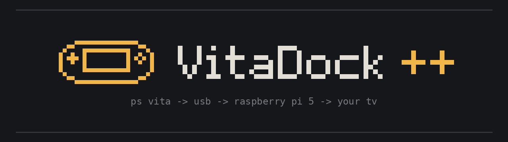
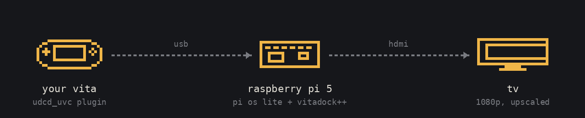

<p align="center">
  
</p>

<p align="center">
  
  
  <a href="https://github.com/Streety-1/VitaDockPlusPlus/releases/latest"></a>
  
</p>

# VitaDock++

VitaDock++ was created as a successor to SilentNightx's [VitaDock+](https://github.com/SilentNightx/VitaDockPlus), which seems to of been discontinued since its last update in November 2023, only works on Pis up to the Pi 4 and has a near 4GB image. Mine is exclusive to the Raspberry Pi 5 running Pi OS Lite, as this offers the best experience with minimal input delay and a one line installer.

<p align="center">
  
</p>

You put a plugin on the Vita that makes it act like a USB webcam (and with some plugins a USB sound card too), plug it into the Pi, and the Pi puts it on the TV. There's no desktop running and nothing to log into after the install. When the Vita's unplugged you get a waiting screen, and everything else is in a menu on the TV that works with a keyboard, mouse or USB pad.

## What you need

- A hacked PS Vita (HENkaku/taiHEN). If yours isn't done yet, [vita.hacks.guide](https://vita.hacks.guide/) is the place to start.
- A Raspberry Pi 5. Any amount of RAM is fine.
- The official Pi 5 power supply. Cheap ones cause weird problems, and the official 27W one also lets the dock charge the Vita faster (see [charging](#charging)).
- A micro SD card, 8GB or bigger, and a micro HDMI to HDMI cable.
- A USB cable for the Vita. Micro USB for the slim, Sony's own cable for the original. It has to be a data cable, plenty of cheap ones only charge.
- A USB keyboard, mouse or pad for the Pi. You need it to install, and to use the menu. Your actual controller pairs with the Vita, not the Pi.

## Setting up the Vita

First pick a plugin. You only put one on the Vita, and the dock works out which one you've got when you plug in.

- [udcd_uvc](https://github.com/xerpi/vita-udcd-uvc/releases) by xerpi is the original. Picture only, so sound goes over a cable or the dock's Bluetooth audio. It's the most tested one, so start with this if you're not sure.
- [vitastream](https://github.com/devnoname120/vitastream/releases) by devnoname120 is udcd_uvc with sound over USB added. Open source, but new, and its notes say that release hasn't been tested on a real console yet.
- [VitaUSBStream](https://github.com/BMK-Studio/VitaUSBStream) by BMK-Studio also does picture and sound over USB. It's a beta with no release or source code out yet, and you have to switch streaming on in its *VUS Control* app each time.

### udcd_uvc or vitastream

Both come in three versions. The ones ending `_lcd_off.skprx` (slim) and `_oled_off.skprx` (original) turn the Vita's screen off while it's docked, which saves battery and helps it charge. The plain `.skprx` one leaves the screen on and works on either.

1. Copy the plugin onto your memory card or SD2Vita. VitaShell's USB mode only shows that, not the Vita's internal storage.
2. In VitaShell on the Vita, copy it from there into `ur0:tai/`.
3. Open `ur0:tai/config.txt` in VitaShell and add it under `*KERNEL` using the filename you copied:
   ```
   *KERNEL
   ur0:tai/udcd_uvc_lcd_off.skprx
   ```
   Only have one of these plugins in there at once. If you're swapping, replace the line.
4. Reboot the Vita.

If it won't boot afterwards, hold L while it starts up to skip plugins, then fix the config. To check it's working, plug the Vita into a PC and it should come up as a camera.

### VitaUSBStream

Follow [its readme](https://github.com/BMK-Studio/VitaUSBStream). It installs as a `.vpk`, and you open *VUS Control* and switch streaming on before plugging into the dock. Take any udcd_uvc line out of `config.txt` first.

## Installing on the Pi

1. Flash **Raspberry Pi OS Lite (64-bit)** with [Raspberry Pi Imager](https://www.raspberrypi.com/software/). In Imager's settings set a username and password, and your Wi-Fi if you're not using a cable. It needs the internet for the install.
2. Boot the Pi with a keyboard plugged in and log in.
3. Run:
   ```
   curl -fsSL https://raw.githubusercontent.com/Streety-1/VitaDockPlusPlus/main/install.sh | bash
   ```
4. Say yes, give it a few minutes, and let it reboot.

That's the last time you need to type anything. From then on the Pi boots straight into the dock.

If you'd rather not type the curl line, download the repo onto a USB stick, plug it into the Pi, and run `sudo mount /dev/sda1 /mnt` then `bash /mnt/VitaDockPlusPlus/install.sh` (use whatever you called the folder). The same works for updating.

## Using it

Plug the Vita into any USB port on the Pi and the game comes up on the TV. Unplug it and you're back at the waiting screen.

To open the menu, press Enter on a keyboard, click a mouse, or press A on a USB pad. Mid-game it's Esc, Tab or the Windows key, a right click, or the PS/Home button (or Start and Select together).

In the menu, up and down move, Enter or A picks something, and Esc or B goes back. Left and right change a setting without opening it. Everything has a description at the bottom of the screen, so you can poke around without breaking anything. It's split up like this:

- **picture**: what the Pi asks the Vita for, sharpness, speed, and the TV mode
- **sound**: sound over USB, Bluetooth audio, and the dock's own sounds
- **wi-fi**: see what the Pi's connected to, or join another network
- **power and charging**: USB power for the Vita, restart and shut down
- **system**: what's plugged in, updates, uninstalling
- **help**: the controls and plugins, in case you forget

## The picture

The default is native resolution, pixel perfect, fast.

The Vita's screen is 960x544, which is almost exactly half of 1080p. So by default the dock asks the Vita for its real resolution and doubles every pixel with no smoothing, which is why it looks sharp instead of mushy. To fit 1080 exactly it trims 2 lines off the top and bottom, which you won't notice. On a 4K TV it does exactly the same at 4x. If you'd rather have the softer look that fills the screen, set sharpness to smooth.

For real 720p there's the *720p (sharpscale)* video mode. That needs [Sharpscale](https://forum.devchroma.nl/index.php?topic=112.0) plus a 720p patch for the game on the Vita, and only runs at 30fps. You don't need it for everything above.

## Input delay

There are three speeds:

- **fast** (the default). The Pi 5's display hardware does the scaling, and if anything falls behind, the old frame gets thrown away instead of queued up. Queued-up frames are what give most capture setups half a second of lag.
- **super fast** goes further. There's no buffering at all, it runs at realtime priority, and the USB and video are kept on one CPU core. If your TV can do 1080p at 120Hz, it uses that (restart once after picking it).
- **compatible** uses mpv. It has more delay, but it's there as a fallback, and the dock switches to it by itself if the other two don't work on your setup.

Whichever speed you pick, the dock also runs the CPU at full speed, stops USB power saving from pausing the Vita, and locks the TV to a proper 60Hz (or 120Hz) at boot.

The other half of the delay is your TV, so turn on **game mode** for that HDMI input. It makes as much difference as anything above.

If you want to measure it, put the normal screen-on plugin on the Vita, film the Vita and the TV together in slow motion on your phone, and count the frames between them.

## Sound

- **Over USB** if you're using vitastream or VitaUSBStream. Nothing to set up, the dock notices and plays it out of the TV. The Vita's own speaker goes quiet while it does, that's normal.
- **A 3.5mm cable** from the Vita's headphone socket to the TV or speakers. Works with any plugin and is the most reliable. If you hear a hum, try a ground loop isolator.
- **Bluetooth** (a bit experimental) for udcd_uvc. Turn it on under *sound*, pick *pair the vita over bluetooth*, then on the Vita go to Settings > Devices > Bluetooth Devices and pick VitaDock++. After that you just connect from the Vita.

## Charging

The Vita only charges from the dock if you turn on **Settings > System > USB Power Supply** on the Vita. If you turned it off to stop a hum on a cable, it needs to be back on.

Even then it's slow. The Pi's USB ports are the same kind as a computer's, so the Vita only takes about 500mA from them. While you're playing that roughly breaks even. Two things help:

- Use the screen-off version of the plugin (`_lcd_off` or `_oled_off`). The Vita's screen is the biggest drain, so with it off more power goes to the battery.
- If you've got the official 27W (5A) power supply, turn on **usb power for the vita** under *power and charging*. The Pi 5 only gives its USB ports 600mA between them unless it knows it's on a 5A supply, and this lifts that to 1.6A. Don't turn it on with a weaker supply.

## Controllers

Pair your controller with the Vita, since that's what's running the game. DualShock 3 and 4 work out of the box, and [MiniVitaTV](https://github.com/TheOfficialFloW/MiniVitaTV) is worth having so games use their PS TV control layouts. Touch controls don't work while it's on the TV, so pick games that are fine on buttons.

## Updating

Pick *check for updates* under *system*. If there's a new version it asks first, then shows a progress bar while it installs and restarts the dock when it's done. Your settings are kept. The first update after a big release can take a few minutes because it has to download new packages. If something goes wrong it tells you what, and the full log is in `/var/log/vitadock-update.log`.

Running the installer again (curl line or USB stick) also updates it.

On 1.1.0 to 1.3.0 the update option was broken. It works now, but the old screen just says "updating" with no progress bar, so leave it 5 to 10 minutes. Or run the installer again.

## Uninstalling

*system > uninstall vitadock++* removes everything, puts the boot settings back and restarts into plain Pi OS Lite.

## Troubleshooting

*system > what's plugged in* shows what the Pi can see. For a terminal, press Ctrl+Alt+F2 on a keyboard while the menu or waiting screen is up and log in. Alt+F1 takes you back to the dock. From there, `vitadock status` and `journalctl -u vitadock -n 50` help too.

<details>
<summary>black screen or "no signal"</summary>

Turn the TV on before the Pi. Use the HDMI port next to the power socket. If it's still blank, set *picture > tv resolution* to *tv's choice* and restart.
</details>

<details>
<summary>the waiting screen shows but the Vita never appears</summary>

Try another USB cable, loads only charge. Reboot the Vita. Lots of Vita plugins, or a slow SD2Vita setup, can stop the video plugin connecting. If it doesn't show up as a camera on a PC either, it's the Vita side.
</details>

<details>
<summary>"vita found but no picture"</summary>

Usually the video format. Edit `/etc/vitadock.conf`, change `VITA_PIXFMT=auto` to `VITA_PIXFMT=yuyv422` and reboot. If it started after you picked super fast or fast, the dock will drop back to compatible by itself after a couple of tries.
</details>

<details>
<summary>no sound, not even the dock's chime</summary>

Go to *sound > test the sound*. It lists every sound output the Pi has. Pick one and it plays a little tune. If it doesn't work, it says why. When you hear the tune, press enter again and the dock keeps using that one. Check the TV isn't on mute and that *dock sounds* is on.

If the chime works but there's no game sound, *what's plugged in* tells you whether the Vita is sending sound over USB at all. Only vitastream and VitaUSBStream do. udcd_uvc is picture only.
</details>

<details>
<summary>colours look off</summary>

The dock tells the display the Vita sends full-range colour, which is what the plugin uses. If it looks too dark or too punchy on yours, set `COLOR_FIX=off` in `/etc/vitadock.conf`.
</details>

<details>
<summary>a big black border round the picture</summary>

Pixel perfect only uses whole-number scaling, so on some TV modes it can't fill the screen. Use 1080p or 4K for the TV mode, or switch sharpness to smooth.
</details>

<details>
<summary>it still feels laggy</summary>

Turn on game mode on the TV first. Then make sure the speed is fast or super fast (*system > what's plugged in* shows which one's actually running) and the video mode is a 60fps one.
</details>

<details>
<summary>an update failed</summary>

The update screen says why. Most of the time the Pi isn't online, which you can sort out under *wi-fi*. Otherwise run the installer again.
</details>

<details>
<summary>Bluetooth audio crackles or won't connect</summary>

It's experimental. It usually settles down after a minute. If it won't connect at all, turn it off and on again under *sound* and pair again.
</details>

If none of that helps, [open an issue](https://github.com/Streety-1/VitaDockPlusPlus/issues). A photo of *what's plugged in* helps a lot.

## Credits

- [xerpi](https://github.com/xerpi) for [vita-udcd-uvc](https://github.com/xerpi/vita-udcd-uvc). None of this would work without it.
- [SilentNightx](https://github.com/SilentNightx) and the original VitaDock team (Bu, ZoidBerg, Si, David-OX and Crash) for [VitaDock+](https://github.com/SilentNightx/VitaDockPlus) and the original VitaDock.
- [devnoname120](https://github.com/devnoname120) for [vitastream](https://github.com/devnoname120/vitastream) and [BMK-Studio](https://github.com/BMK-Studio) for [VitaUSBStream](https://github.com/BMK-Studio/VitaUSBStream).
- [TheOfficialFloW](https://github.com/TheOfficialFloW), Team Molecule and everyone behind HENkaku and taiHEN.
- [GStreamer](https://gstreamer.freedesktop.org/), [mpv](https://mpv.io/), [pygame](https://www.pygame.org/), [Plymouth](https://www.freedesktop.org/wiki/Software/Plymouth/) and [bluez-alsa](https://github.com/arkq/bluez-alsa), which do the heavy lifting on the Pi.

## Disclaimer

This is a fan project. It's not affiliated with or endorsed by Sony Interactive Entertainment or Raspberry Pi Ltd. PlayStation and PS Vita are trademarks of Sony Interactive Entertainment, and Raspberry Pi is a trademark of Raspberry Pi Ltd.

VitaDock++ doesn't include, download or help you get any games. It just shows what your own Vita is outputting. Modding your Vita is at your own risk, as is everything else here. It comes as-is with no warranty, so if something breaks, that's on you.

## Licence

[MIT](LICENSE).
